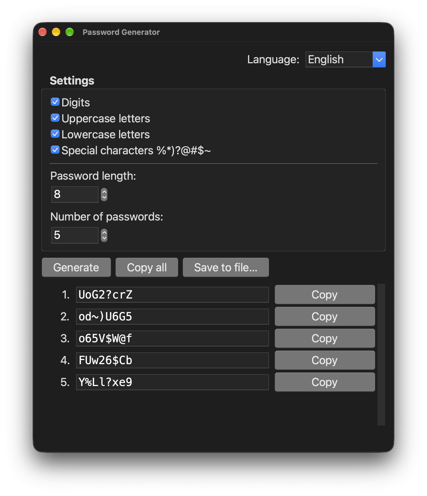

# Password Generator

A small, dependency-free password generator written in pure Python.
Use it from the terminal or through a simple desktop window.

<p align="center">
  
</p>

- Choose character sets: digits, uppercase letters, lowercase letters, special characters (`% * ) ? @ # $ ~`)
- Every password contains at least one character from each selected set
- Set the password length (default: 8) and how many passwords to generate (default: 5)
- Uses the [`secrets`](https://docs.python.org/3/library/secrets.html) module, which is designed for generating secure passwords
- No third-party packages, only the Python standard library
- Ready-to-run apps for macOS, Windows and Linux

## Download

Get the latest build from the [Releases](../../releases/latest) page. No Python required.

| Platform | File | How to run |
|---|---|---|
| macOS (Apple Silicon) | `PasswordGenerator-macOS.zip` | Unzip and move **Password Generator.app** to *Applications* |
| Windows 10/11 | `PasswordGenerator-Windows.zip` | Unzip and run **Password Generator.exe** |
| Linux (x86-64) | `PasswordGenerator-Linux.tar.gz` | `tar -xzf PasswordGenerator-Linux.tar.gz && ./password-generator` |

The apps are not signed, so the system warns you the first time you open them:

- **macOS:** *“Password Generator” cannot be opened because Apple cannot check it for malicious software.*
  Right-click the app, choose **Open**, then **Open** again. Or run once:
  `xattr -dr com.apple.quarantine "/Applications/Password Generator.app"`
- **Windows:** *Windows protected your PC* (SmartScreen). Click **More info → Run anyway**.

## Run from source

### Requirements

| Mode | Python | Notes |
|---|---|---|
| Command line | 3.9+ | Standard library only |
| Desktop window | 3.10+ | Needs `tkinter` (see below) |

`tkinter` ships with the python.org installers for macOS and Windows.
Some distributions package it separately:

```sh
brew install python-tk@3.15        # macOS, Homebrew (match your Python version)
sudo apt install python3-tk        # Debian / Ubuntu
sudo dnf install python3-tkinter   # Fedora
```

Check that it is available:

```sh
python3 -c "import tkinter; print(tkinter.TkVersion)"
```

### Command line

```sh
python3 passgen.py [options]
```

| Option | Description |
|---|---|
| `-d`, `--digits` | Include digits |
| `-u`, `--upper` | Include uppercase letters |
| `-w`, `--lower` | Include lowercase letters |
| `-s`, `--special` | Include special characters `%*)?@#$~` |
| `-l`, `--length N` | Password length (default: 8) |
| `-n`, `--count N` | Number of passwords (default: 5) |
| `-h`, `--help` | Show help |

If no character set is selected, all four are used.
The length must be at least the number of selected sets.

#### Examples

```sh
# 5 passwords of 8 characters, all character sets
python3 passgen.py

# 3 passwords of 16 characters, letters and digits only
python3 passgen.py -u -w -d -l 16 -n 3

# A 6-digit PIN
python3 passgen.py -d -l 6 -n 1

# Save 20 passwords to a file
python3 passgen.py -l 12 -n 20 > passwords.txt
```

### Desktop window

```sh
python3 passgen_gui.py
```

- Toggle character sets and set the length (1–128) and count (1–100)
- **Generate** (or press <kbd>Enter</kbd>) creates a new list
- **Copy** next to each password copies just that one; **Copy all** copies the whole list
- **Save to file…** (<kbd>⌘</kbd>+<kbd>S</kbd> on macOS, <kbd>Ctrl</kbd>+<kbd>S</kbd> on Windows and Linux) writes all passwords to a text file, one per line
- Switch the interface language between **English**, **Русский** and **Srpski** from the drop-down in the top-right corner

The selected language is remembered in:

- macOS: `~/Library/Application Support/passgen/settings.json`
- Windows: `%APPDATA%\passgen\settings.json`
- Linux: `~/.config/passgen/settings.json`

English is used when no setting has been saved yet.

## Project structure

```
passgen.py       # Password generation logic and the command-line interface
passgen_gui.py   # Desktop window (tkinter)
i18n.py          # Interface translations
assets/icon.png  # App icon
.github/workflows/release.yml  # Builds the apps
```

## Building the apps

The apps are built with [PyInstaller](https://pyinstaller.org) by GitHub Actions
(`.github/workflows/release.yml`) on macOS, Windows and Linux.

- **Release:** push a version tag. The workflow builds all three apps and attaches them to a new release.
  ```sh
  git tag v1.0.0
  git push origin v1.0.0
  ```
- **Test build:** run the workflow manually from the *Actions* tab. The files appear under the run's *Artifacts*.

To build locally (PyInstaller and Pillow are needed for building only):

```sh
python3 -m venv .venv && source .venv/bin/activate
pip install pyinstaller pillow
pyinstaller --windowed --name "Password Generator" --icon assets/icon.png \
  --add-data "assets/icon.png:assets" passgen_gui.py
# Result: dist/Password Generator.app (macOS) or dist/Password Generator (Windows, Linux)
```

## Adding a language

Open `i18n.py`, add the language to `LANGUAGES`, and add a dictionary to `STRINGS`
with the same keys as the existing ones:

```python
LANGUAGES = {"en": "English", "ru": "Русский", "sr": "Srpski", "de": "Deutsch"}

STRINGS = {
    ...
    "de": {
        "title": "Passwortgenerator",
        "generate": "Generieren",
        ...
    },
}
```

The window size adjusts automatically to fit the longest translation.

## License

[MIT](LICENSE)
